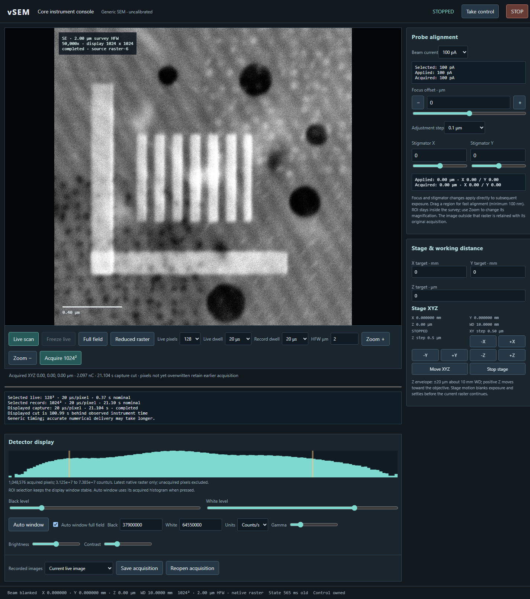

# vSEM

A virtual scanning electron microscope for developing AI-assisted SEM operation.
Use the browser console for human practice and the separate instrument API for
automation. Both operate the same causal instrument engine.

This is an initial **research/developer release** with a generic, uncalibrated
low-relief specimen model. It is a working sandbox for core imaging and control;
it is not a calibrated digital twin or a connection to a real microscope.

## Included

- Stage X/Y/Z, physical field width/zoom, visible focus and two-axis stigmation.
- Continuous raster scans, small alignment ROIs and single acquisitions up to
  **1024 × 1024** native count pixels; within-raster parameter history.
- Progressive image delivery, retained survey underneath ROI scans, count-window
  histogram/auto-window, gamma, brightness and contrast for display only.
- A finite, offline-prepared 1.28 mm specimen with morphology at multiple scales.
  Runtime generation is disabled; outside the specimen is vacuum with zero counts.
- Acquisition timing, shot noise, exposure accounting, beam blanking and Stop.
  Slow rendering is allowed; images are not delivered ahead of physical exposure.
- Separate browser session/CSRF and API bearer authentication on loopback ports.
  Operator observations exclude seeds, ideal settings and hidden specimen fields.

**Charging and beam damage are inactive in this release.** Its material codes
reserve 27 morphology/sensitivity/conductivity combinations; these do not mean
27 activated damage/charging scenarios. See [scientific scope](docs/SCIENCE.md).

See the [illustrated GUI walkthrough](docs/GUI_WALKTHROUGH.md) for real screenshots,
control locations and reproducible focus, stigmation, stage/zoom, survey, 1024-pixel
acquisition and alignment-ROI scenarios.

[](docs/GUI_WALKTHROUGH.md)

## Setup

The numerical runtime currently requires **Linux or WSL2, Python 3.10 and an
explicitly selected NVIDIA CUDA GPU**. The qualified configuration is Python
3.10.12, RTX 3090 Ti (24 GB), CUDA 12.1 PyTorch wheels, and approximately 67 GB
available Linux RAM. Other GPUs/memory sizes are not yet qualified. The full
specimen uses about 9.3 GB on disk and GPU, plus numerical work and runtime caches.
Keep substantial additional disk space for caches and acquired episode records.
There is no CPU renderer or implicit GPU/cloud fallback.

The source checkout is the deployment unit; run commands from its root. CPU tests
do not need a GPU. Install a Python 3.10 interpreter and its `venv` support first.

```bash
git clone https://github.com/BenjaminZingsem/vSEM.git
cd vSEM
python3.10 -m venv .venv
source .venv/bin/activate
python -m pip install -r requirements.txt
python -m pip install -r requirements-gpu.txt
nvidia-smi --query-gpu=uuid,name,memory.total --format=csv
export VSEM_GPU_UUID=GPU-your-chosen-physical-uuid
```

Choose an idle compute GPU; preserve your display GPU when you have two. Startup
requires no compute processes and at most 320 MiB already occupied on the selected
device. This is an exclusivity check, not a cap on simulation memory. Clones share
a per-user advisory GPU lock; see [deployment notes](docs/DEPLOYMENT.md).

Prepare the world once, before operating the instrument:

```bash
python -B scripts/prepare_finite_catalogue.py --output data/sample-1280um --side-regions 16 --plan-only
python -B scripts/prepare_finite_catalogue.py --output data/sample-1280um --side-regions 16
sha256sum data/sample-1280um/manifest.json
```

Preparation refuses to overwrite existing or partial output, verifies every
stored file and prints the manifest hash. It requires all 27 material-code
combinations. Smaller `--side-regions` values can be rejected for missing coverage.
Generated worlds are not checked into Git; no dataset account or image download
is required. Preserve the preparation receipt alongside your dataset.

Start explicitly with the printed hash and a new run directory:

```bash
python -B -m runtime.serve --no-world-generation \
  --catalogue-directory data/sample-1280um \
  --catalogue-manifest-sha256 PASTE_MANIFEST_SHA256 \
  --run-directory runs/review-001
```

Open the invitation URL printed in that terminal. **Ctrl+C** closes the server and
its owned instrument processes. The server stays in the foreground; no browser
or persistent background process is launched automatically. Follow the current
[human review instructions](docs/HUMAN_REVIEW.md).

## Automation

Read [the instrument API guide](docs/API.md) and the standalone
[example client](examples/agent_client.py). Give a trusted development agent only
the API origin and token, not the browser invitation or server filesystem.

```bash
export VSEM_API_ORIGIN=http://127.0.0.1:8123
export VSEM_API_TOKEN=PASTE_PRIVATE_API_TOKEN
python -B examples/agent_client.py --output runs/agent-acquisition-001 --pixels 1024
```

The administrator obtains the API token from the run's private `connection.json`.
Never commit this file. Authentication and an observable-only HTTP interface do
**not** provide OS confinement for an untrusted evaluated agent. Keep development
agents trusted until a separately audited evaluation deployment exists.

## Tests and contributions

```bash
python -B -m unittest discover -s acceptance -p 'test_*.py'
node acceptance/test_scan_display_buffer.js
node acceptance/audit_intensity_transfer.js apps/web/intensity_transfer.js acceptance/intensity_transfer_cases.json
python -B scripts/audit_publication.py
```

CPU CI checks physical accounting, causal transitions, public contracts, catalogue
validation, resource ownership and display retention. Actual GPU/HTTP/1024 gates
are separate and must be run on approved hardware before a numerical release;
see [validation](docs/VALIDATION.md). Historical private process tapes are omitted
and their one replay test is explicitly skipped, rather than counted as passed.

See [CONTRIBUTING](CONTRIBUTING.md), [SECURITY](SECURITY.md),
[roadmap](docs/ROADMAP.md) and [provenance](docs/PROVENANCE.md).
Licensed under [MIT](LICENSE).
