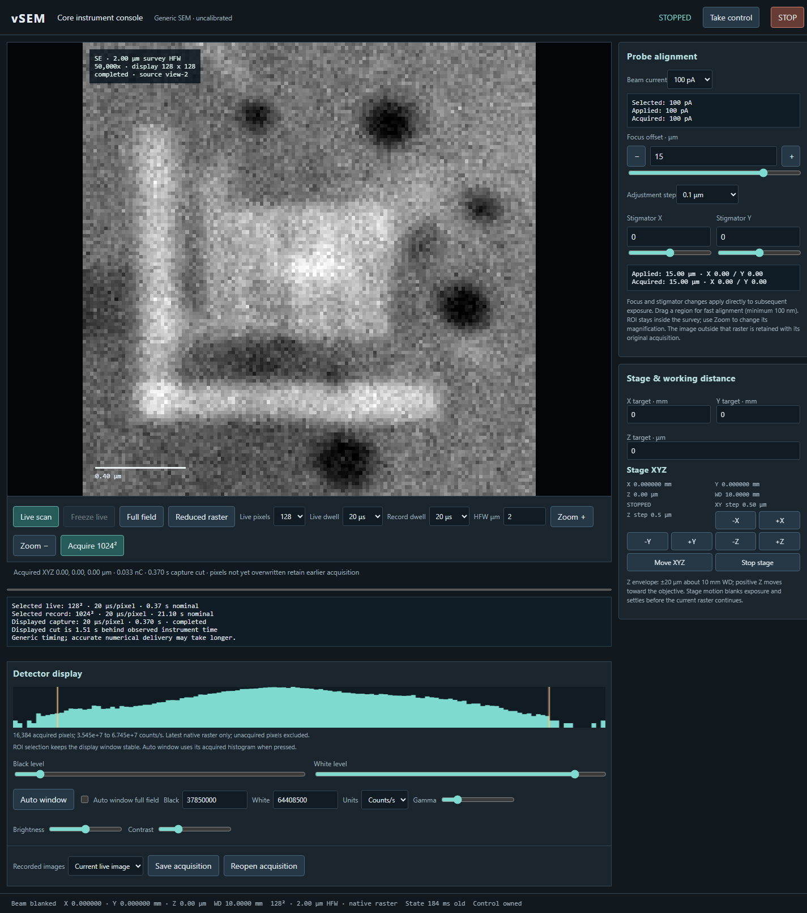
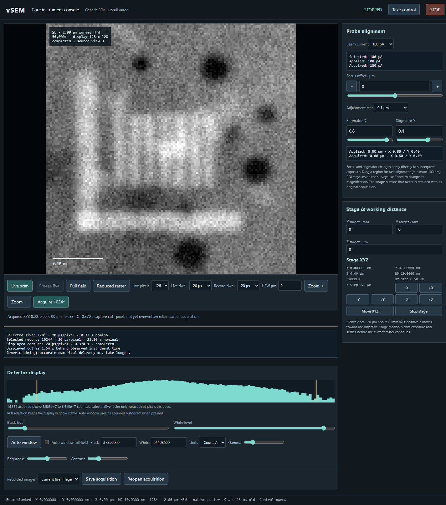
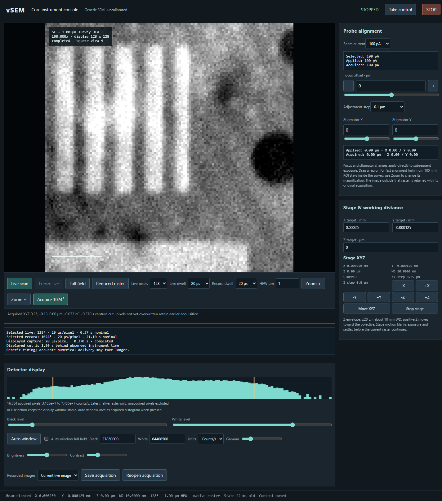
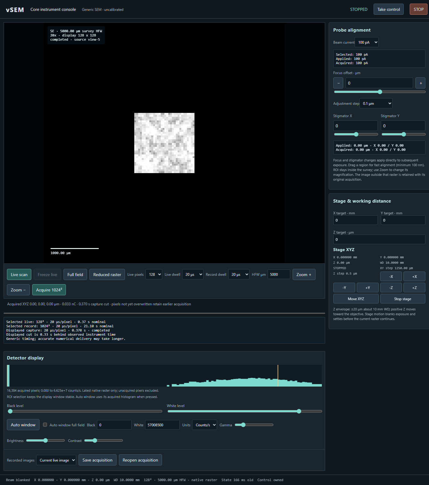
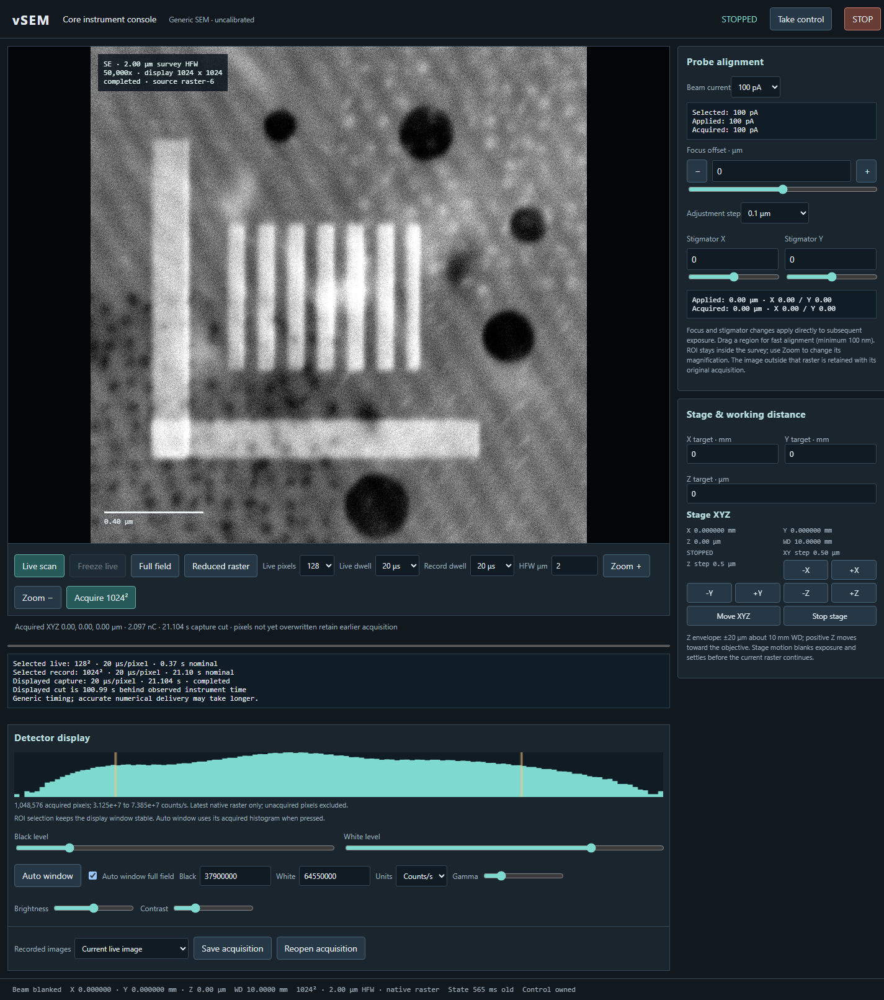
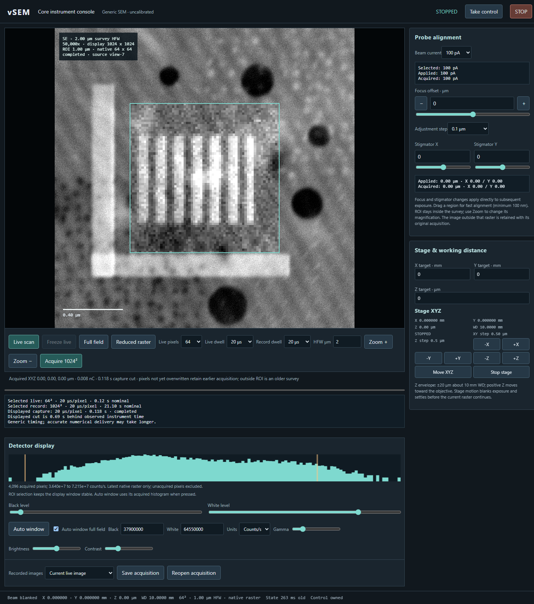

# Illustrated GUI walkthrough

These are real browser captures of the **v0.1.0 research release**, acquired from
the finite procedural specimen through the normal GUI. No microscope image or
control state was added to the screenshots. Click any image to inspect it at full
size. Shot noise, timing and exact grey levels will vary between acquisitions.

Start the service using [the README](../README.md#setup), open its private browser
invitation and click **Take control** at the top right. The examples below assume
the default 1.28 mm specimen, a fresh session, **100 pA**, **20 μs** dwell, and
stage X/Y/Z, focus and both stigmators initially zero. This is an uncalibrated,
ideal-grounded model; **charging and beam damage are inactive** in this release.

## Find the controls

| Location in the screenshot | Controls and purpose |
|---|---|
| Top right | **Take control** obtains the GUI lease. **STOP** blanks exposure and stops the instrument. |
| Large image, left | Acquired SE counts, image/ROI geometry and a physical scale bar. Drag here to select an alignment ROI. |
| Directly below the image | **Live scan**, **Freeze live**, **Full field**, **Reduced raster**, **Live pixels**, **Live dwell**, **Record dwell**, **HFW μm**, **Zoom +**, **Zoom −**, **Acquire 1024²**. |
| Upper right: **Probe alignment** | **Beam current**, **Focus offset · μm**, focus step, **Stigmator X/Y**. Numeric entries and sliders apply directly; there is no Apply button. |
| Lower right: **Stage & working distance** | X/Y targets in **mm**, Z in **μm**, direction buttons, **Move XYZ**, actual position and working-distance readbacks. |
| Below the scan timing readback: **Detector display** | Histogram, black/white range, **Auto window**, units, gamma, brightness and contrast. These change presentation, not acquired raw counts. |
| Bottom left | **Recorded images**, **Save acquisition**, **Reopen acquisition**. |
| Bottom status bar | Beam state, actual stage position, working distance, scan geometry, state age and control ownership. |

On shorter screens, scroll down to reach **Detector display** and file controls.

Read **Applied** and **Acquired**, not just the editable setting. A requested
change can wait for response preparation; already exposed pixels retain their
original settings. Numerical image delivery can lag physical acquisition. The
scan readback distinguishes preparation, exposure and delivery. **Freeze live**
finishes the current live sweep; **STOP** can interrupt it.

## 1. Bring the reference pattern in and out of focus

1. Set **HFW μm** to `2`, **Live pixels** to `128` and **Live dwell** to `20 μs`.
2. Click **Live scan**. Once the pattern appears, click **Freeze live** and wait
   for a completed capture. The narrow vertical bars should be distinguishable.
3. Click **Auto window** under the histogram, then clear **Auto window full field**.
   Keep that black/white range, gamma `1`, brightness `0` and contrast `1` for
   comparisons. Automatic rescaling can otherwise obscure changes in contrast.
4. In **Probe alignment**, enter `15` in **Focus offset · μm**. Click **Live scan**,
   then **Freeze live**. Wait until **Applied** and **Acquired** both show `15.00 μm`.
5. Return focus to `0` and repeat the scan. The bars recover. For interactive
   adjustment, leave live scanning on and use the slider or the `+`/`−` buttons;
   choose **Fine · 0.05 μm** when approaching a sharp setting.

| Focus 0 μm | Focus +15 μm, same display window |
|---|---|
|  |  |

The screenshots use 128 native pixels for a quick comparison; their visible
pixelation is expected. **Acquire 1024²** resolves more spatial detail.

## 2. Recognise and correct astigmatism

1. Restore focus `0`, stage X/Y/Z `0`, and HFW `2 μm`.
2. Enter `0.8` for **Stigmator X** and `0.4` for **Stigmator Y**. Start a live scan.
3. Compare the bars and rounded dark features with the focused reference. Fine
   structure loses definition with a direction-dependent probe response.
4. Adjust each stigmator toward `0`, allowing the **Acquired** readback to catch
   up before comparing. Revisit focus and repeat small X/Y corrections. Use the
   reduced raster described below to work on a small feature.

These values demonstrate a reversible defect in this reference scene. They are
not a calibration recipe for a real SEM or an ideal-setting API for an AI agent.

## 3. Move the stage, zoom, and compensate Z with focus

1. Restore focus and stigmators to `0`, with **HFW μm** `2`.
2. Under **Stage & working distance**, set **X target · mm** to `0.00025`,
   **Y target · mm** to `-0.000125`, and **Z target · μm** to `0`. Click **Move XYZ**.
   Wait for the actual position readbacks to settle, then scan. The same specimen
   features move left/up for this particular X/Y displacement.
3. Click **Zoom +** once: HFW becomes `1 μm`. If frozen, click **Live scan** again.
   Features now occupy more of the field; the scale bar and reported magnification
   change. **Zoom −** doubles HFW. Zoom changes the full viewport.
4. For Z pre-focus practice, return X/Y/Z to `0`, HFW to `2`, and scan. Set Z to
   `15 μm` and click **Move XYZ**. The reduced working distance changes focus.
   Compensate by setting focus to `-15 μm` in this generic reference model.
   Restore both Z and focus to `0` afterward.

The direction buttons step X/Y by one quarter of the selected HFW; Z steps are
`0.5 μm`. Target entries do not move the stage until **Move XYZ** is clicked.
Stage movement blanks exposure and settles before rastering continues. Keep the
combined focus offset plus Z within `±25 μm`; Z itself is bounded to `±20 μm`.

## 4. Survey the finite specimen and its vacuum surroundings

1. Return X/Y/Z, focus and stigmators to `0`.
2. Enter `5000` in **HFW μm**. Use **Live pixels** `128`, then **Live scan** and
   **Freeze live**. Click **Auto window** for this different signal distribution.
3. The prepared 1.28 mm specimen occupies only part of the 5 mm field; the exterior
   is vacuum with zero sample counts. No new terrain is generated during runtime.
4. Return HFW to `2` and scan to revisit the central reference pattern. The GUI's
   full-field range is `1–5000 μm`; smaller alignment ROIs are described below.

The coarse survey integrates many small features into each native pixel. It does
not reveal the same detail as a high-magnification acquisition. Material codes
inside the specimen do not activate charging/damage feedback in this release.

## 5. Acquire and save a native 1024 × 1024 image

1. Set HFW to `2 μm`, stage X/Y/Z, focus and stigmators to `0`, and **Record dwell**
   to `20 μs`. Re-enable **Auto window full field** if desired.
2. Click **Acquire 1024²**. This requests a single full-field acquisition regardless
   of the live pixel setting. Wait for the image caption to say **completed**.
3. The selected nominal duration is about 21.1 seconds plus any blank/settle holds.
   Accurate numerical preparation/delivery can take longer; **STOPPED** alone does
   not establish that the final image has been delivered. Watch the scan readback.
4. Click **Save acquisition**. The `.vsem.json` file contains native counts and
   captured metadata. Use **Reopen acquisition** to display it again without
   collecting another exposure. **Recorded images** selects completed single
   acquisitions retained in the current session.

To demonstrate a within-raster change, start another 1024 acquisition, wait for
**Acquiring** and a partly filled physical progress bar, then change focus to
`15 μm`. Later exposure reflects the change once admitted; earlier rows retain
their original settings. A **mixed acquisition** readback and the saved
`parameter_segments` provide evidence. A change made only during numerical
delivery cannot change an exposure that already ended. Avoid changing **Live
pixels** during a recording unless you intend to interrupt it and start live
scanning on the new pixel grid.

## 6. Align in an ROI while retaining the 1024 survey

1. Display the completed 1024 acquisition from the previous step.
2. Click **Reduced raster**. It selects a central square at half the survey HFW,
   switches to `64` live pixels and starts scanning that ROI automatically.
3. Alternatively, drag a square over a feature directly in the image. The ROI
   stays within the survey and has a minimum width of `100 nm`. A tiny click/drag
   is ignored; make a clearly visible selection.
4. Adjust focus or stigmators while the ROI refreshes. Its newly acquired pixels
   overlay the retained survey; pixels outside the ROI still show the older
   acquisition. **Freeze live** finishes the current ROI sweep.
5. Click **Full field** to leave reduced-raster alignment. Use **Live scan** if
   frozen. Use **Zoom +/−** when the intention is to change the entire field.

The image caption distinguishes survey HFW, ROI geometry and native raster size.
The histogram describes the latest native raster, not a newly acquired whole
survey. ROI selection keeps the existing display window stable. Press **Auto
window** explicitly if you want a window derived from the ROI's counts. Saving
here saves the selected ROI's native acquisition, not a flattened composite of
the old survey and new ROI.

## Display adjustments and finishing

After changing **Beam current**, use **Auto window** if the image looks too dark
or bright. **Black level/White level** sliders, or numeric **Black/White** values,
choose which count range maps to black and white. Select **Counts/s** to compare
rates across dwell settings, or **Counts** for acquired counts. Gamma, brightness
and contrast affect display only; they cannot correct the physical probe focus
or modify saved raw counts.

Press **STOP** when finished and **Ctrl+C** in the launcher terminal to close the
service and its owned children. Do not include browser invitations or private
connection files in issue reports. For structured feedback, follow
[HUMAN_REVIEW.md](HUMAN_REVIEW.md).

Capture provenance, settings and file hashes are in
[screenshots/captures.json](screenshots/captures.json). The temporary capture
service and browser were closed after capture; these illustrations do not imply
that a public or background review instance is running.
